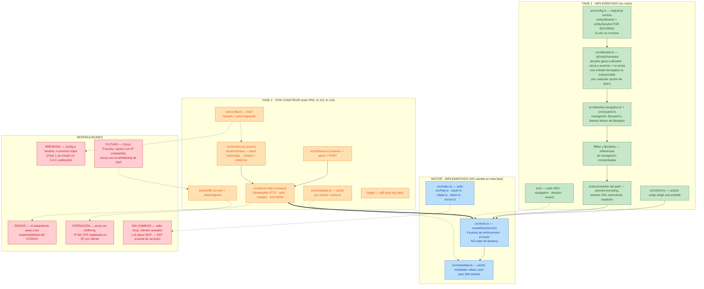

# PRD: Servicio Hospedado Multi-Tenant (`ssff-mcp serve`) — Transporte Remoto Streamable HTTP

| Metadato | Valor |
|---|---|
| **Documento** | PRD-feature-multitenant-hosting.md |
| **Versión** | v1.1.0 — añade §11: mapa de implementación y repercusión |
| **Estado** | PROPUESTO / LISTO PARA REVISIÓN |
| **Fecha** | 2026-10-18 |
| **Componente** | `ssff-mcp` — transporte remoto, tenancy y despliegue |
| **Autoría** | AI Engineering & Cloud Infrastructure Architecture Team |
| **Alineación previa** | `ROADMAP.md` (Fase 2 de 3). **Sustituye a `PRD-feature-http-sse-transport.md`**, cuyos `D-97..D-106` / `FR-127..FR-140` quedan retirados. Este documento arranca en **D-115 / FR-154**. Continúa el modelo de permisos de Fase 1 (`entityAllowlist` + `entityDenylist` por entorno). |

---

## 1. Resumen ejecutivo y objetivos

### 1.1 Situación actual

`ssff-mcp` es un proceso local con transporte `stdio`. Cada analista necesita Node.js en su máquina, un fichero `config.json` local con credenciales de SuccessFactors y mantenerlo actualizado. En entornos corporativos esto choca con tres barreras reales:

1. **Endpoint**: las políticas de seguridad prohíben credenciales técnicas de SAP en los portátiles; los antivirus/EDR cortan instalaciones y ejecución local.
2. **Red**: SuccessFactors puede exigir `IP whitelisting` (API login exceptions); los usuarios conectan desde redes dinámicas y son rechazados.
3. **Operación**: actualizar el servidor o rotar credenciales exige tocar puesto a puesto.

### 1.2 Objetivo

Convertir `ssff-mcp` en un **servicio centralizado multi-tenant** sobre **Streamable HTTP**, desplegable en un contenedor, donde el cliente se conecta por **URL + clave**. El aislamiento entre clientes deja de ser una propiedad del despliegue y pasa a ser **responsabilidad del código**, con invariantes explícitas (§6).

### 1.3 Fuera de alcance (Fase 3)

**Usuarios y roles** (IdP, `grupos → rol → allowlist`) no forman parte de este documento. Aquí el sujeto de autorización es el **tenant**; el rol llega después.

---

## 2. Ledger de decisiones (D-115 … D-124)

| ID | Decisión | Origen / justificación |
|---|---|---|
| **D-115** | **Dualidad de transporte.** `stdio` sigue siendo el modo por defecto. El HTTP remoto se activa solo con `ssff-mcp serve` o con la variable `PORT`. | Cero impacto en los usuarios locales actuales. |
| **D-116** | **Transporte: Streamable HTTP** (`StreamableHTTPServerTransport` del SDK). Se descarta SSE: `SSEServerTransport` está marcado `@deprecated`. | El SDK instalado (1.31.0) documenta el sustituto explícitamente. Retira `D-98`/`D-99` del PRD anterior. |
| **D-117** | **Un motor, dos entrypoints.** `createMcpServer()` (`src/tools.ts`) es el motor; el transporte es lo único que varía. | Estructuralmente ya es así: `src/index.ts` solo conecta el transporte. No son dos MCPs. |
| **D-118** | **El motor no sabe de tenancy.** Recibe un config **ya resuelto**. El borde lo resuelve: en local, un único tenant; en hospedado, el tenant desde la clave. | Mantiene el motor intacto y permite convivir ambos modos sin duplicar lógica. |
| **D-119** | **Config unificada a `tenants`**, con base por tenant y **override por entorno**. Auto-migración: la forma plana (top-level `environments`) se envuelve como un único tenant. | Rompe el config plano publicado → **major version**. Ver §5.3. |
| **D-120** | **Auth de conexión por clave.** La clave resuelve **tenant + entornos permitidos**; se guarda **hasheada** y se compara en tiempo constante. `environment` es argumento de tool, no propiedad de conexión. | La clave acota qué entornos puede invocar quien la presenta. Fail-closed. |
| **D-121** | **Caché por tenant.** `$metadata` y tokens OAuth se cachean por **tenant + entorno**; la caché se persiste en volumen. | Dos clientes con alias `prod` colisionarían en una caché única; sin volumen, cada redeploy re-descarga ~7,5 MB por tenant/entorno. |
| **D-122** | **Invariantes de aislamiento** (§6.1): tenant resuelto una vez, contexto explícito, fail-closed, sin estado global, logs con tenant. | Un bug de resolución o de clave de caché = fuga de datos entre clientes. |
| **D-123** | **Despliegue en contenedor**: Dockerfile multi-etapa no-root, `GET /healthz` sin auth, apagado ordenado. El proxy inverso **no debe bufferizar** la ruta del MCP. | Dokploy/Traefik sin ajuste corta el streaming de Streamable HTTP. |
| **D-124** | **Config por fichero montado; secretos por entorno.** El `config.json` (tenants, entornos, listas, hashes de clave) va en un volumen y se relee en cada llamada; las credenciales de SAP se resuelven con `fromEnv`. | El fichero **no guarda secretos**; añadir o editar un tenant no exige redeploy. |

---

## 3. Especificación del protocolo y endpoints

```
   Cliente MCP (Claude · OpenCode · VS Code/Copilot · Codex · Pi · agy)
              │
              │  POST /mcp   Authorization: Bearer <clave>   Accept: application/json, text/event-stream
              ├─────────────────────────────────────────────► ssff-mcp serve
              │                                                   │
              │  1. auth:  clave → { tenant, entornos permitidos } │
              │                                                   │
              │  2. tools/call con `environment`                  │
              │     → valida environment ∈ scope de la clave      │
              │                                                   ├──────► SAP SuccessFactors
              │  3. respuesta (JSON directo o stream SSE)         │        (OData v2, HTTPS)
              │◄──────────────────────────────────────────┤◄──────┘
```

### 3.1 Endpoints

| Ruta | Métodos | Auth | Propósito |
|---|---|---|---|
| `/mcp` | `POST`, `GET`, `DELETE` | **Sí** | Endpoint único de Streamable HTTP. `POST` envía JSON-RPC; `GET` abre el stream de mensajes del servidor; `DELETE` termina la sesión. La sesión viaja en la cabecera `Mcp-Session-Id`. |
| `/healthz` | `GET` | No | Liveness/readiness. Devuelve 200 sin tocar SAP. |

### 3.2 Autenticación

- Cabeceras aceptadas: `Authorization: Bearer <clave>` o `X-API-Key: <clave>`.
- Claves **hasheadas** en el fichero; comparación con `crypto.timingSafeEqual`.
- **Fail-closed**: clave ausente, desconocida o sin entorno válido ⇒ `401` con cuerpo saneado. Nunca hay tenant por defecto.

---

## 4. Requisitos funcionales

- **FR-154 (MUST)** — El servidor DEBE soportar el subcomando `ssff-mcp serve` con `--port`, `--host` (por defecto `0.0.0.0`) y `--config` (ruta del fichero).
- **FR-155 (MUST)** — Si `PORT` está definida y no hay subcomando, el servidor DEBE arrancar en modo HTTP en ese puerto.
- **FR-156 (MUST)** — Sin `serve` ni `PORT`, el servidor DEBE arrancar en `stdio` con paridad total respecto al comportamiento actual.
- **FR-157 (MUST)** — El config DEBE aceptar el nivel `tenants`; la forma plana DEBE migrarse automáticamente a un único tenant.
- **FR-158 (MUST)** — La autenticación DEBE resolver `tenant` y entornos permitidos desde la clave presentada, con comparación de tiempo constante sobre hashes.
- **FR-159 (MUST)** — Clave ausente o desconocida ⇒ `401`. **Prohibido** cualquier tenant, entorno o lista por defecto.
- **FR-160 (MUST)** — Una llamada cuyo `environment` quede fuera del scope de la clave DEBE rechazarse antes de cualquier petición de red.
- **FR-161 (MUST)** — Las cachés de `$metadata` y de tokens DEBEN estar separadas por tenant y entorno; ninguna lectura puede cruzar tenants.
- **FR-162 (MUST)** — `GET /healthz` DEBE responder 200 sin autenticación, en menos de 10 ms y sin contactar con SAP.
- **FR-163 (MUST)** — Ante `SIGTERM`/`SIGINT` el servidor DEBE dejar de aceptar conexiones, cerrar las activas en un máximo de 10 s y terminar limpiamente.
- **FR-164 (MUST)** — DEBE existir un límite de sesiones concurrentes configurable por entorno (por defecto 50). Al superarse, nuevas conexiones reciben `503`.
- **FR-165 (MUST)** — El tope de tamaño de respuesta (`maxResponseBytes`) DEBE seguir aplicándose por request individual, también dentro de `batch_get`.
- **FR-166 (MUST)** — Los logs DEBEN ser de metadatos (tenant, sesión, método, duración, resultado). **Prohibido** registrar tokens, claves o credenciales.
- **FR-167 (SHOULD)** — Las respuestas de error DEBEN ser saneadas y no revelar la existencia, datos o configuración de otro tenant.
- **FR-168 (SHOULD)** — DEBE documentarse el bloque de conexión por cliente para Claude Desktop, OpenCode, VS Code/Copilot, Codex, Pi y agy.
- **FR-169 (MUST)** — El proyecto DEBE incluir un `Dockerfile` multi-etapa con usuario no root y un `.dockerignore` que excluya `node_modules`, `.git`, tests y ficheros de configuración.
- **FR-170 (SHOULD)** — DEBE existir un helper (`ssff-mcp key hash`) que genere el `apiKeyHash` a partir de una clave en claro, para no hand-hashear al dar de alta un tenant.

---

## 5. Diseño técnico

### 5.1 Componentes

| Componente | Responsabilidad |
|---|---|
| `src/config.ts` | Esquema estricto con `tenants`; auto-migración del config plano. |
| `src/tenancy.ts` (nuevo) | `resolveTenant(claves, clavePresentada) → { tenantId, entornosPermitidos }`. Lógica **pura**, testeable sin red. |
| `src/server-http.ts` (nuevo) | Servidor HTTP nativo + `StreamableHTTPServerTransport`; middleware de auth; `/healthz`; ciclo de vida de sesiones; apagado ordenado. |
| `src/cli/serve.ts` (nuevo) | Subcomando `serve` y detección de `PORT`. |
| `src/metadata.ts` | Claves de caché con prefijo de tenant. |
| `src/tools.ts` | **Sin cambios de lógica**: los 9 puntos de enforcement ya pasan por `isEntityPermitted`; cambia la *procedencia* de las listas (contexto del tenant). |
| `Dockerfile` + `.dockerignore` | Empaquetado. |

### 5.2 Flujo de una llamada

1. El middleware lee la clave y resuelve `{ tenant, entornosPermitidos }`.
2. Se construye un contexto explícito y se pasa hacia abajo. **No** hay estado global mutable.
3. `tools/call` valida `environment` contra el scope de la clave.
4. El config resuelto del tenant aporta credenciales, `baseUrl` y listas.
5. La caché se lee/escribe con clave `tenant + entorno`.

### 5.3 Esquema de config (y migración)

```json
{
  "tenants": {
    "acme": {
      "apiKeyHash": "…",
      "entityAllowlist": [ { "entity": "User" }, { "entity": "EmpJob" } ],
      "entityDenylist":  [ { "entity": "PerPersonal" } ],
      "environments": {
        "dev":  { "baseUrl": "…", "auth": { "…": "…" }, "apiKeyHash": "…" },
        "test": { "baseUrl": "…", "auth": { "…": "…" }, "apiKeyHash": "…" },
        "prod": { "baseUrl": "…", "auth": { "…": "…" } }
      }
    }
  }
}
```

- `tenants.<t>.apiKeyHash` → clave de cliente: alcanza **todos** sus entornos.
- `tenants.<t>.environments.<env>.apiKeyHash` → clave que alcanza **solo** ese entorno.
- `entityAllowlist` / `entityDenylist`: base en el tenant, **override por entorno**. Precedencia vigente de Fase 1: `denylist > allowlist > permisos de la cuenta`.
- **Auto-migración**: si el fichero trae `environments` en la raíz, se envuelve como `tenants.<default>` y se emite un aviso por stderr.

---

## 6. Seguridad y gobernanza (DS)

### 6.1 Invariantes de aislamiento (obligatorias)

1. El tenant se resuelve **una sola vez** en el borde y se propaga como contexto explícito.
2. Toda clave de caché (`$metadata`, tokens) es **tenant + entorno**.
3. **Fail-closed** en todo: clave, tenant o entorno desconocidos ⇒ rechazo.
4. Credenciales, listas y logs se leen **siempre** del contexto del tenant.
5. `environment` se valida **contra el tenant resuelto**, nunca al revés.

### 6.2 Decisiones de seguridad

- **DS-MTH-01** — El cliente MCP **nunca** ve ni envía credenciales de SAP. Autenticación backend-a-backend.
- **DS-MTH-02** — El fichero de configuración **no contiene secretos**; las credenciales se resuelven con `fromEnv` desde el panel de despliegue.
- **DS-MTH-03** — Claves hasheadas y comparadas en tiempo constante.
- **DS-MTH-04** — TLS terminado en el proxy; el tramo hacia SuccessFactors es HTTPS obligatorio. Sin texto plano en ningún salto.
- **DS-MTH-05** — El endpoint HTTP DEBE validar `Host`/`Origin` (protección anti-DNS-rebinding), usando los helpers del SDK.
- **DS-MTH-06** — El proxy inverso **no bufferiza** la ruta del MCP (streaming).

---

## 7. Plan de pruebas y validación

1. **Unitarias (puras)** — `resolveTenant`: clave válida/ausente/desconocida; scope de entornos; tiempo constante.
2. **Config** — esquema `tenants`, override por entorno, auto-migración del plano, rechazo de claves desconocidas.
3. **Aislamiento (la red de seguridad)** — dos tenants con el mismo alias `prod` no comparten caché ni credenciales; una clave de A nunca alcanza B; `environment` fuera de scope ⇒ rechazo; clave desconocida ⇒ 401.
4. **HTTP** — `/healthz` sin auth; `401` sin clave; sesión con `Mcp-Session-Id`; `503` al superar el límite; apagado ordenado con `SIGTERM`.
5. **Contenedor** — build de la imagen, arranque, `curl` a `/healthz`, montaje de config y caché.
6. **Regresión** — la suite completa en verde y `stdio` byte-a-byte igual que antes.

---

## 8. Despliegue

### 8.1 Destino

- **Ahora**: VPS propio, gestionado con **Dokploy** (Traefik interno) + **TLS** (Let's Encrypt).
- **Más adelante**: SAP BTP Cloud Foundry.

### 8.2 Puesta en marcha (piloto)

1. Aplicación en Dokploy desde el `Dockerfile`.
2. **Volúmenes**: uno para el `config.json` (editable en caliente) y otro para la **caché** `$metadata`/tokens.
3. **Variables de entorno**: credenciales de SAP (`fromEnv`), puerto, límite de sesiones.
4. **Dominio + TLS** por Dokploy; verificar que la ruta del MCP **no bufferiza**.
5. **Healthcheck**: `/healthz`.
6. **Registrar la IP pública del VPS** en el SF del cliente (*API login exceptions*).
7. Entregar al cliente **URL + clave** y su bloque de config.

### 8.3 Riesgo conocido para Cloud Foundry (fase posterior)

En Cloud Foundry el egreso **suele** ir por **IPs compartidas**, no dedicadas — incompatible con el `IP whitelisting` de SAP. Antes de migrar habrá que **verificarlo** y, si aplica, resolverlo con proxy/NAT de IP fija o ampliando el whitelisting.

---

## 9. Estimación

- **Complejidad**: media-alta. No por el transporte (el SDK lo trae), sino por el **aislamiento multi-tenant**.
- **Story Points**: 13.
- **Tiempo estimado**: 5 a 7 días laborables, incluyendo pruebas de aislamiento.

---

## 10. Fuera de alcance / siguientes fases

- **Fase 3**: identidad de usuario, roles y **allowlist por rol** (IdP: SAP IAS). Incluye verificar PKCE, registro de cliente (CIMD/DCR) y el claim de grupos en el `.well-known` de IAS.
- **Alta de tenants por API**: en esta fase el alta es **manual** en el fichero, con helper de hash.
- **Rate-limit por clave**: no en v1; el tope de sesiones global es suficiente para el piloto.

---

## 11. Mapa de implementación y repercusión

Estado real del repositorio frente a este PRD: qué está **implementado y dónde**, qué queda **por construir**, y qué **repercusión** tiene cada pieza.



**Lectura:**

- **Verde (Fase 1):** todo integrado en `main` — permisos por entorno, navegación, `$expand` (incluido `$select` anidado), `$filter`/`$orderby` y el path blindado. Es la base de esta fase.
- **Azul (motor):** lo que **no se toca**. La flecha gruesa `server-http ⇒ createMcpServer()` es la **costura clave**: el HTTP nuevo entra por el borde y el motor queda intacto.
- **Naranja (Fase 2):** lo que falta — tres ficheros nuevos (`tenancy.ts`, `server-http.ts`, `cli/serve.ts`), dos modificados (`config.ts`, `metadata.ts`) y el empaquetado.
- **Rojo (repercusiones):** la única **breaking** es el config (`D1`); el riesgo estructural es `D2` (el aislamiento vive en código); `D5` es la garantía — el usuario local y el plano hacia SAP no cambian.
