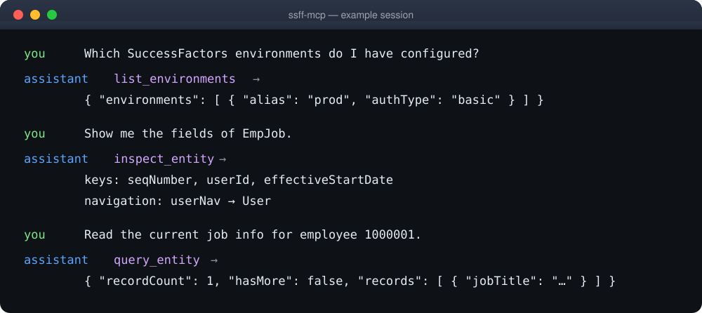

# ssff-mcp

[](https://www.npmjs.com/package/ssff-mcp)
[](LICENSE)
[](package.json)
[](https://github.com/chiptime/ssff-mcp/actions/workflows/ci.yml)


A local, **read-only** MCP (Model Context Protocol) server for **SAP
SuccessFactors OData v2**. It lets an AI assistant — OpenCode, Claude Desktop,
Cursor, Codex, Pi, or any MCP client — read your SuccessFactors data through
natural language, safely: read-only by construction, one page per call, and with
no way to write anything.

> **Release status.** The published npm version is **0.3.0**. The `inspect_entity`
> tool, the `ssff-mcp cache invalidate` command, the configurable response-size
> cap and the Custom MDF improvements are on `main` and land in the next release.
> If you need them today, [build from source](docs/development.md#build-and-test).

## 🆚 ssff-mcp vs calling OData directly

You could write your own SuccessFactors client, but you would handle auth and
token refresh, effective dating, `$batch` envelopes, cursor pagination, error
sanitization and — above all — the read-only boundary yourself. `ssff-mcp` is
exactly that layer, packaged for any MCP client, and it refuses to write by
construction. See the full [comparison](docs/faq.md#how-it-compares).

## ✨ Key features

- **Read-only by construction.** No tool can write; the boundary lives in server
  code, never in a prompt.
- **Schema-aware.** `inspect_entity` and MCP resources browse the data model
  without spending a data query.
- **Safe by default.** HTTPS-only, sanitized errors, metadata-only stderr logs,
  secrets never logged.
- **Efficient reads.** One page per call, signed cursor continuation, and one
  GET-only `$batch` for up to 180 reads.
- **Any MCP client.** A local STDIO server — no HTTP port, no third-party proxy.
- **Cross-platform.** Linux, macOS and Windows; Basic or OAuth 2.0 per
  environment.

## 📋 Requirements

- **Node.js >= 20** (Linux, macOS, Windows).
- Any MCP client: OpenCode, Claude Desktop, Cursor, Codex, Pi, or another.
- **pnpm** — only if you build from source. The installed CLI needs nothing
  beyond Node.

## 🚀 Getting started

Run the configuration wizard — it asks for your tenant URL and credentials,
validates them live against `$metadata`, writes `~/.config/ssff-mcp/config.json`
and prints the block for your client:

```bash
npx -y ssff-mcp@latest init
```

Then paste that block into your client and restart it. Already have a
configuration file? The **standard config** works in most tools:

```json
{
  "mcpServers": {
    "ssff-mcp": {
      "command": "npx",
      "args": ["-y", "ssff-mcp@latest"]
    }
  }
}
```

<details>
<summary><b>OpenCode</b> — <code>opencode.json</code></summary>

```json
{
  "mcp": {
    "servers": {
      "ssff-mcp": {
        "type": "local",
        "command": ["npx", "-y", "ssff-mcp@latest"],
        "environment": {}
      }
    }
  }
}
```
</details>

<details>
<summary><b>Claude Desktop</b> — <code>claude_desktop_config.json</code></summary>

```json
{
  "mcpServers": {
    "ssff-mcp": {
      "command": "npx",
      "args": ["-y", "ssff-mcp@latest"],
      "env": {}
    }
  }
}
```
</details>

<details>
<summary><b>Cursor</b> — <code>~/.cursor/mcp.json</code></summary>

```json
{
  "mcpServers": {
    "ssff-mcp": {
      "command": "npx",
      "args": ["-y", "ssff-mcp@latest"],
      "env": {}
    }
  }
}
```
</details>

<details>
<summary><b>Pi</b> — <code>~/.pi/agent/mcp.json</code></summary>

```json
{
  "mcpServers": {
    "ssff-mcp": {
      "command": "npx",
      "args": ["-y", "ssff-mcp@latest"],
      "env": {}
    }
  }
}
```
</details>

<details>
<summary><b>Codex</b> — <code>~/.codex/config.toml</code></summary>

```toml
[mcp_servers.ssff-mcp]
command = "npx"
args = ["-y", "ssff-mcp@latest"]
```
</details>

Install globally instead of with `npx` (`npm install -g ssff-mcp`, then run
`ssff-mcp`), or [build from source](docs/development.md#build-and-test).

## ⚙️ Configuration

### Hosted service (Streamable HTTP)

This source branch also provides `ssff-mcp serve`: one API-key-authenticated
service with isolated tenants and environment-scoped keys. Local STDIO stays the
default (a non-empty `PORT` selects HTTP). For the Dokploy pilot — mounted config,
TLS, secrets, and remote-client examples — see **[Hosting →](docs/hosting.md)**.
No new npm release or finished deployment is claimed here, and
users/roles/IAS remain a later phase.

The usual way is the `ssff-mcp init` wizard (see Getting started above): it
writes `~/.config/ssff-mcp/config.json` and prints the block for your client. To
edit the file by hand, or for OAuth, the per-environment entity allowlist and
denylist, secret providers and inline mode, see **[Configuration →](docs/configuration.md)**.

## 💬 What you can ask

You drive the assistant in natural language; it picks the tool.

- "List my SuccessFactors environments."
- "Which entities can I read, and which of them are custom?"
- "Show me the schema of `EmpJob` — keys, fields and navigations."
- "Read the current job info for employee `1000001`."
- "Get the employees in `PerPersonal` whose last name is García, with id, name and email."
- "Fetch these five entities at once: …" *(one `$batch` request)*

## 🎬 Demo

The assistant picks the tools and answers from the records it reads (output
shapes are real; values are illustrative):



## 🔒 Security

`ssff-mcp` is read-only by construction: no POST/PUT/PATCH/DELETE can come from
tool input, credentials travel over HTTPS only (or not at all, in inline mode),
errors are sanitized and logs are metadata-only on stderr. Use a
least-privileged, read-only SuccessFactors account. Details in
[Security](docs/security.md).

## 🧰 Tools

| Tool | What it does |
|---|---|
| `list_environments` | Lists the configured environments (aliases and auth type). |
| `inspect_entity` | Reads the data model: entity catalog, schema and Custom MDF classification. |
| `query_entity` | Reads one entity with `$filter`/`$orderby`/`$select`/`$expand`/`$top`/`$skip` and effective dating. |
| `batch_get` | Runs up to 180 read-only GETs in one GET-only `$batch` request. |

Plus read-only [MCP resources](docs/tools.md#mcp-resources) for browsing the
schema. Full argument reference: **[Tools & Resources →](docs/tools.md)**.

## 📚 Documentation

| Document | Contents |
|---|---|
| [Configuration](docs/configuration.md) | Config path, fields, Basic/OAuth auth, secret providers, entity allowlist, inline mode, locale, response-size cap. |
| [Tools & Resources](docs/tools.md) | The four tools and their arguments, query encoding and effective dating, pagination/cursors, MCP resources, Custom MDF discovery, examples. |
| [FAQ & comparison](docs/faq.md) | Common questions and how it compares to the SF UI, raw OData and ad-hoc scripts. |
| [Security](docs/security.md) | Read-only guarantees, secrets, logging, metadata cache, limits and scope. |
| [Troubleshooting](docs/troubleshooting.md) | Every error code and how to fix it. |
| [Development](docs/development.md) | Build, test, the opt-in integration test, contributing. |

## 🤝 Contributing

Issues and pull requests are welcome at
[chiptime/ssff-mcp](https://github.com/chiptime/ssff-mcp). See
[Development](docs/development.md) for the build, the test suite and the opt-in
integration test. Please keep changes read-only in spirit: this server must never
gain the ability to write to SuccessFactors.

## 👤 Maintainers

[@chiptime](https://github.com/chiptime).

## 📄 License

[MIT](LICENSE) — Copyright (c) 2026 ChipTime. Published on npm as
[`ssff-mcp`](https://www.npmjs.com/package/ssff-mcp).
